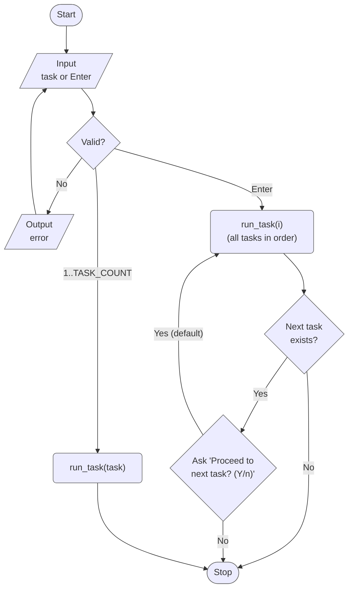
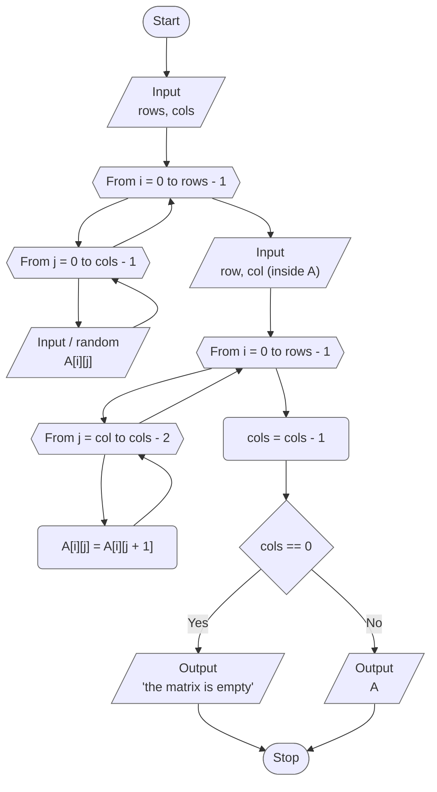
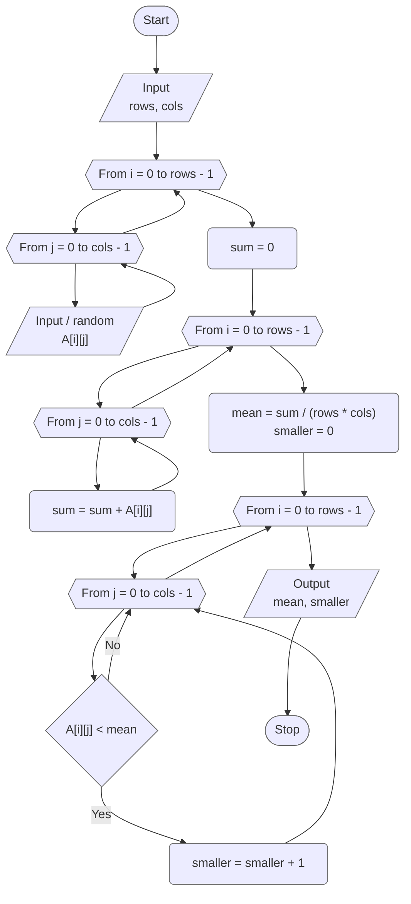
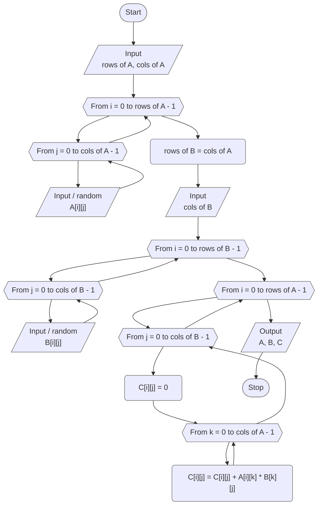

# Lab 05 - Two-dimensional arrays

[Assignment](docs/lw-task-05.pdf) · [Report](docs/lw-report-05.pdf)

Variant 9. The goal of the lab is to learn to work with two-dimensional arrays:
to fill and print a matrix with nested loops, to process it row by row and
column by column, and to build new matrices from the given ones.

## Overview

| Task | Option 1 of the assignment                                                          |
|------|-------------------------------------------------------------------------------------|
| 1    | Matrix `6x3`: choose an element `A[i][j]` and delete the column it is in            |
| 2    | Matrix `7x9`: arithmetic mean of the elements and the number of smaller elements    |
| 3    | Matrices `7x9` and `9x4`: product `C = A x B`                                       |

### Project layout

```
lab_05/
├── include/
│   ├── tasks.h   # task registry (X-macro), TASK_COUNT, run_task() / run_all_tasks()
│   ├── utils.h   # validated input
│   └── matrix.h  # constants, matrix functions, Matrix type
└── src/
    ├── main.c    # menu, task number parsing, srand()
    ├── runner.c  # dispatches to run_task1() ... run_task3()
    ├── taskN.c   # each task 'N' in its own source file
    ├── ...
    ├── matrix.c  # implementation of matrix functions
    └── utils.c   # implementation of utility functions
```

## Program flow



## Task 1 - Delete the column of a chosen element

Given a matrix `A` (variant 9: `6x3`), choose an element `A[i][j]` and delete
the column `j` in which it is located. The element is chosen by the user: `i`
and `j` are entered and checked against the size of the matrix.

The column is deleted in place: in every row all elements to the right of the
column `j` move one place to the left, and the number of columns decreases by
one. The matrix `6x3` becomes `6x2`. If the matrix had only one column, nothing
is left and the program says so.



## Task 2 - Mean of the elements and the smaller ones

Given a matrix `A` (variant 9: `7x9`), find the arithmetic mean of its elements
and the number of elements smaller than it. The first pair of nested loops
collects the sum, then `mean = sum / (rows * cols)` (as a real number), the
second pair counts the elements `A[i][j] < mean`.



## Task 3 - Product of matrices

Given a matrix `A` and a matrix `B`, find the product `C = A x B` and write it
into the matrix `C`. `C` has as many rows as `A` and as many columns as `B`, and
each element is the sum of products of a row of `A` and a column of `B`:

```
C[i][j] = A[i][0] * B[0][j] + A[i][1] * B[1][j] + ... + A[i][n-1] * B[n-1][j]
```

where `n` is the number of columns of `A` (and of rows of `B`). Three nested
loops are used: over the rows of `C`, over its columns, and over `k` inside the
sum.



## Results

| Task | Input                                                                   | Output                                                                                 |
|------|-------------------------------------------------------------------------|----------------------------------------------------------------------------------------|
| 1    | `A` is `6x3` with `1 ... 18` by rows, element `A[2][1]`                 | column 1 is deleted, `A` is `6x2`: rows `1 3`, `4 6`, `7 9`, `10 12`, `13 15`, `16 18` |
| 1    | `A` is `1x1`, element `A[0][0]`                                         | `No columns are left, the matrix is empty.`                                            |
| 2    | `A` is `2x3`: `1 2 3` / `4 5 6`                                         | mean `3.5000`, `3` elements are smaller                                                |
| 3    | `A` is `2x3`: `1 2 3` / `4 5 6`, `B` is `3x2`: `7 8` / `9 10` / `11 12` | `C` is `2x2`: `58 64` / `139 154`                                                      |

## Build & run

Standalone (from this directory):

```bash
make build
make run
```

From the repository root:

```bash
make build LAB=05
make run LAB=05
```
