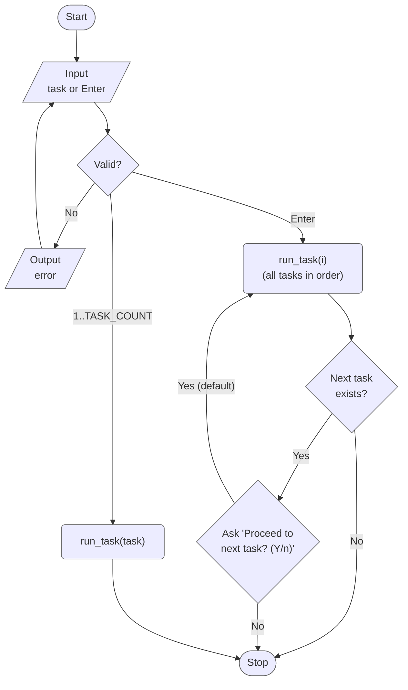
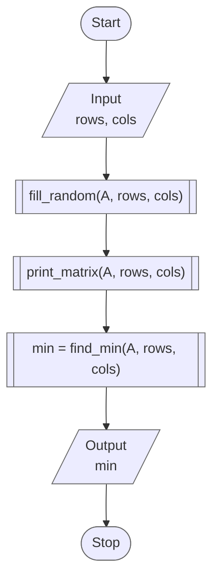
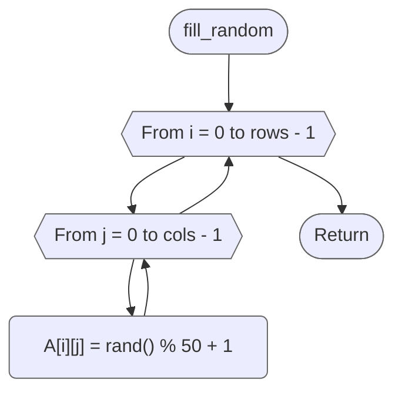
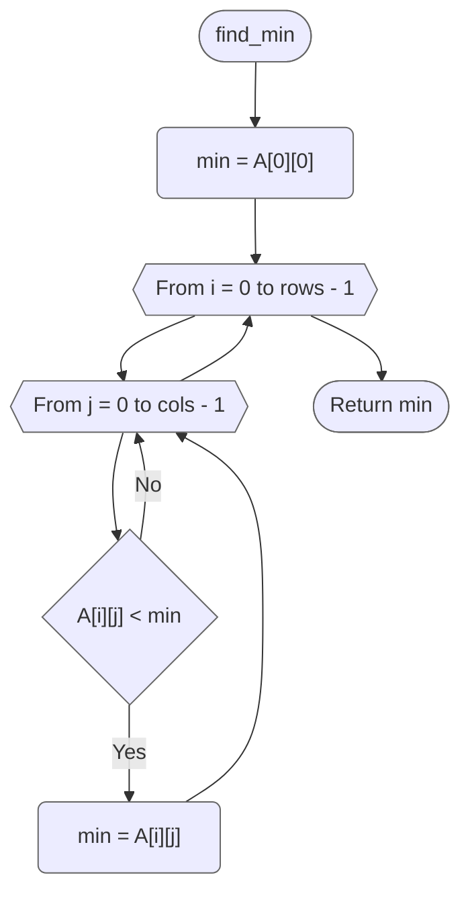
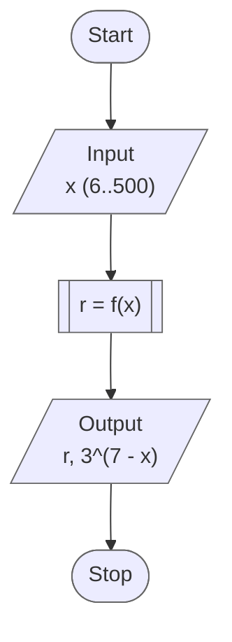
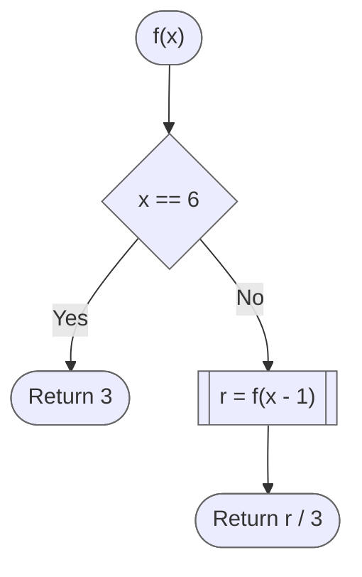
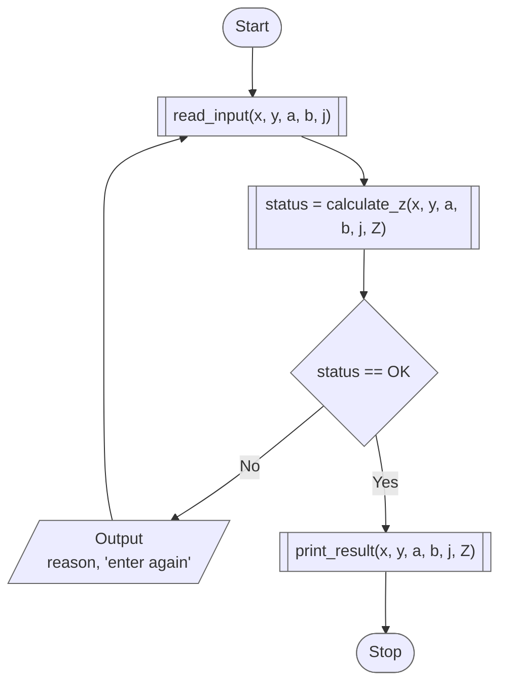
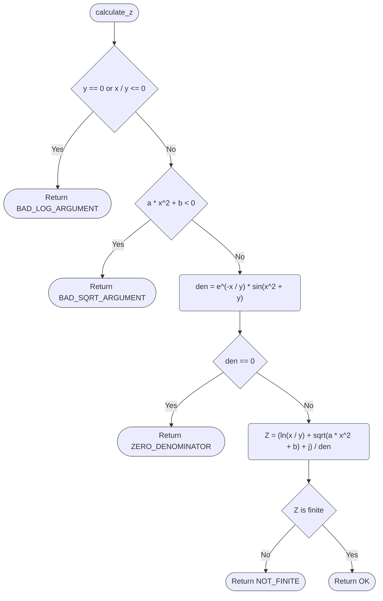

# Lab 06 - Functions

[Assignment](docs/lw-task-06.pdf) · [Report](docs/lw-report-06.pdf)

Variant 9. The goal of the lab is to learn how to describe and apply user
functions: to split a program into functions with parameters and return values,
to pass a two-dimensional array to a function, to use recursion, and to organize
the data exchange between functions without global variables.

## Overview

| Task | What it does                                                                                             |
|------|----------------------------------------------------------------------------------------------------------|
| 1    | Fills an `n x t` array with random numbers `1...50` and finds the minimum element, in separate functions |
| 2    | Calculates the recursive function `f(x)` of variant 4                                                    |
| 3    | Calculates `Z` at a point with three functions: input, calculation, display                              |

### Project layout

```
lab_06/
├── include/
│   ├── tasks.h   # task registry (X-macro), TASK_COUNT, run_task() / run_all_tasks()
│   ├── utils.h   # validated input
│   └── matrix.h  # constants, matrix functions, Matrix type
└── src/
    ├── main.c    # menu, task number parsing, srand()
    ├── runner.c  # dispatches to run_task1() ... run_task3()
    ├── taskN.c   # each task 'N' in its own source file
    ├── ...
    ├── matrix.c  # implementation of matrix functions
    └── utils.c   # implementation of utility functions
```

## Program flow



## Task 1 - Minimum element of a random array

Option 1: a two-dimensional array of `n x t` elements is filled with random
numbers from 1 to 50 and the value of the minimum element is found. The work is
split into separate functions:

| Function                           | Does                                         |
|------------------------------------|----------------------------------------------|
| `fill_random(a, rows, cols)`       | fills the array with random numbers `1...50` |
| `find_min(a, rows, cols)`          | returns the value of the minimum element     |
| `print_matrix("A", a, rows, cols)` | prints the array                             |

A two-dimensional array is passed as `long a[][MAX_MATRIX_DIM]`: the size of the
right dimension (the length of a row) must be given, the left one is not needed.
The function receives a pointer to the first row, so `fill_random` changes the
array of the caller.



`fill_random`:



`find_min`:



## Task 2 - Recursive function

Variant 4 of Table 6.1:

```
         | 3             for x = 6
f(x)  =  |
         | f(x - 1) / 3  for x > 6
```

The argument is a natural number `x >= 6`. The function calls itself with
`x - 1` until it reaches the base case `x = 6`, and the results are then divided
by 3 on the way back. Therefore `f(x) = 3 / 3^(x - 6) = 3^(7 - x)`, which the
program prints as a check:

| `x`  | 6 | 7 | 8      | 9      | 10      |
|------|---|---|--------|--------|---------|
| f(x) | 3 | 1 | 0.3333 | 0.1111 | 0.03704 |



`f(x)`:



## Task 3 - Value of a function at a point

Option 4: find the value of

```
        ln(x / y) + sqrt(a * x^2 + b) + j
Z  =  -------------------------------------
          e^(-x / y) * sin(x^2 + y)
```

The program is split into three functions, as the assignment requires, and the
data goes between them only through parameters, without global variables:

| Function                         | Does                                                                                                                |
|----------------------------------|---------------------------------------------------------------------------------------------------------------------|
| `read_input(&x, &y, &a, &b, &j)` | input of the information: the values are returned through pointers (passing by reference)                           |
| `calculate_z(x, y, a, b, j, &z)` | calculation of the required value: the arguments are passed by value, `Z` through a pointer, the status is returned |
| `print_result(x, y, a, b, j, z)` | display of the results                                                                                              |

The function is defined not for all values, so `calculate_z` returns a status,
and the program reports the reason and asks for the values again:

| Status                    | When                                              |
|---------------------------|---------------------------------------------------|
| `CALC_BAD_LOG_ARGUMENT`   | `y = 0` or `x / y <= 0`, `ln(x / y)` is undefined |
| `CALC_BAD_SQRT_ARGUMENT`  | `a * x^2 + b < 0`                                 |
| `CALC_ZERO_DENOMINATOR`   | `e^(-x / y) * sin(x^2 + y) = 0`                   |
| `CALC_NOT_FINITE`         | the result does not fit into `double`             |



`calculate_z`:



## Results

| Task | Input                                       | Output                                                               |
|------|---------------------------------------------|----------------------------------------------------------------------|
| 1    | `rows = 4`, `cols = 5`                      | a random `4 x 5` array with numbers `1...50` and its minimum element |
| 2    | `x = 6`                                     | `f(6) = 3`                                                           |
| 2    | `x = 8`                                     | `f(8) = 0.3333333333`                                                |
| 2    | `x = 10`                                    | `f(10) = 0.03703703704`                                              |
| 3    | `x = 2`, `y = 1`, `a = 1`, `b = 1`, `j = 1` | `Z = -30.27683415`                                                   |
| 3    | `x = 1`, `y = 0`                            | `x / y must be positive`, the values are asked again                 |

## Build & run

Standalone (from this directory):

```bash
make build
make run
```

From the repository root:

```bash
make build LAB=06
make run LAB=06
```
