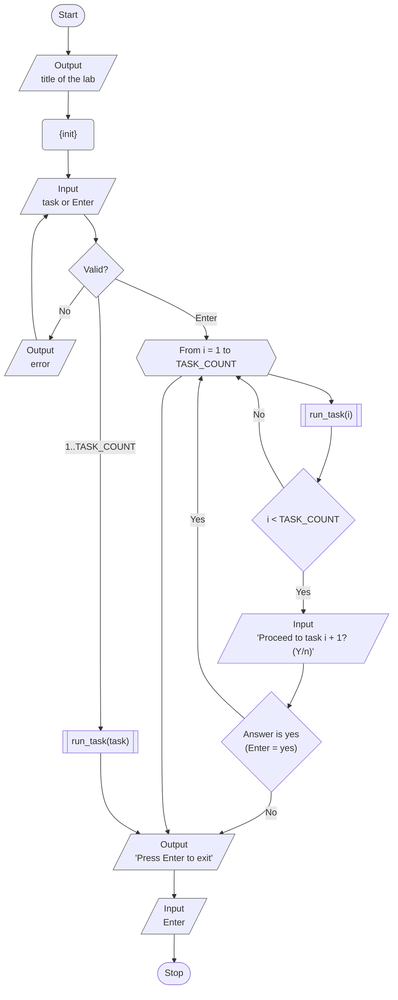
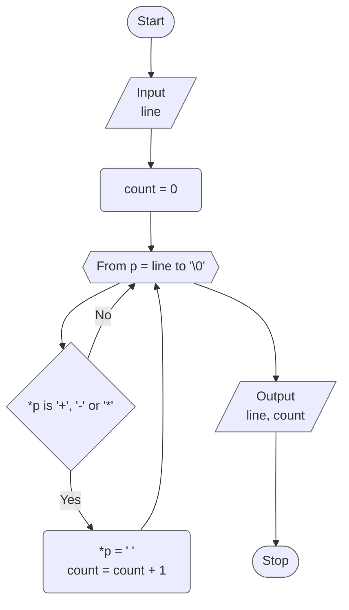
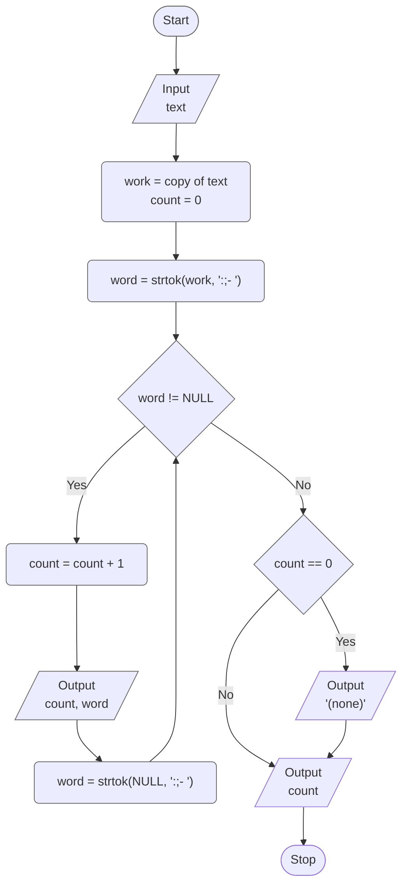
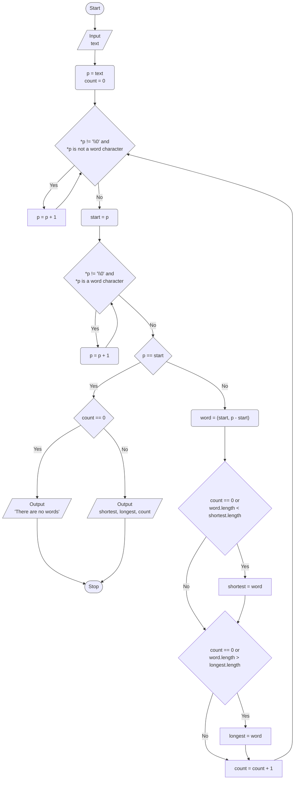

# Lab 07 - Strings

[Assignment](docs/lw-task-07.pdf) · [Report](docs/lw-report-07.pdf)

Variant 9. The goal of the lab is to study the basic algorithms for working with
strings: a string as an array of `char` ending with `'\0'`, reading a line,
going through it character by character, splitting it into words with `strtok()`
and using the functions of `<string.h>`.

## Overview

| Task | Option 1 of the assignment                                                           |
|------|--------------------------------------------------------------------------------------|
| 1    | Replace the symbols `+`, `-`, `*` of the line with spaces                            |
| 2    | Split a text into words separated by `:`, `;`, `-` and a space; print and count them |
| 3    | Find the shortest and the longest word of the line, print them and their lengths     |

### Project layout

```
lab_07/
├── include/
│   ├── tasks.h   # task registry (X-macro), TASK_COUNT, run_task() / run_all_tasks()
│   └── utils.h   # MAX_LINE_SIZE, validated input, read_text_line(), text_length()
└── src/
    ├── main.c    # menu, task number parsing, setlocale()
    ├── runner.c  # dispatches to run_task1() ... run_task3()
    ├── taskN.c   # each task 'N' in its own source file
    ├── ...
    └── utils.c   # implementation of utility functions
```

## Program flow



## Task 1 - Replace the symbols with spaces

The line is read and then gone through character by character with a pointer
`p`. If the character is one of `+`, `-`, `*` (it is searched in the string
`"+-*"` with `strchr()`), it is replaced with a space and counted. The loop
stops at the terminating `'\0'`; the check `*p != '\0'` is needed because
`strchr()` also "finds" the terminating character of the string it searches in.



## Task 2 - Words separated by a colon, a semicolon, a hyphen and a space

The text is split with `strtok()`, the separators are given by the string
`":;- "`. The first call gets the string, the next ones get `NULL` and continue
from the place where the previous call stopped; `NULL` is returned when there
are no more words. `strtok()` writes `'\0'` into the string it splits, so the
work is done on a copy and the entered text stays intact. Several separators in
a row do not produce empty words.



## Task 3 - The shortest and the longest word

The line is scanned once. For every word the function `next_word()` skips the
characters that are not parts of a word, finds the end of the word, and returns
its start, its size in bytes and its length in characters. The words are not
copied: the program keeps only a pointer to the beginning and the size, and the
word is printed with `%.*s`. The length is the smaller of the two for `shortest`
and the larger for `longest`, compared strictly, so the first word wins in case
of a tie. If there are no words, the program says so.



## Results

| Task | Input                              | Output                                                                   |
|------|------------------------------------|--------------------------------------------------------------------------|
| 1    | `2+3-4*5 a+b`                      | `2 3 4 5 a b`, replaced symbols: `5`                                     |
| 1    | `hello world`                      | `hello world`, replaced symbols: `0`                                     |
| 2    | `one:two;three-four five`          | words `one`, `two`, `three`, `four`, `five`; number of words: `5`        |
| 2    | `:;- `                             | `(none)`, number of words: `0`                                           |
| 3    | `I love programming in C language` | shortest `I` (1), longest `programming` (11), words: `6`                 |
| 3    | `ab, cd! ef; gh.`                  | shortest `ab` (2), longest `ab` (2): the first of equal ones, words: `4` |
| 3    | `я люблю програмування в Харкові`  | shortest `я` (1), longest `програмування` (13), words: `5`               |

## Build & run

Standalone (from this directory):

```bash
make build
make run
```

From the repository root:

```bash
make build LAB=07
make run LAB=07
```
