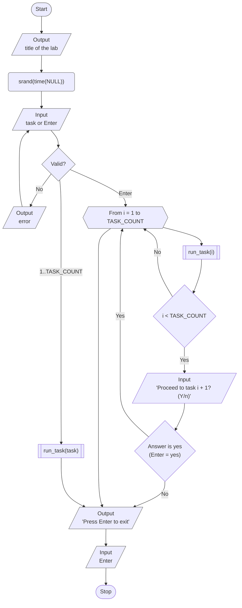
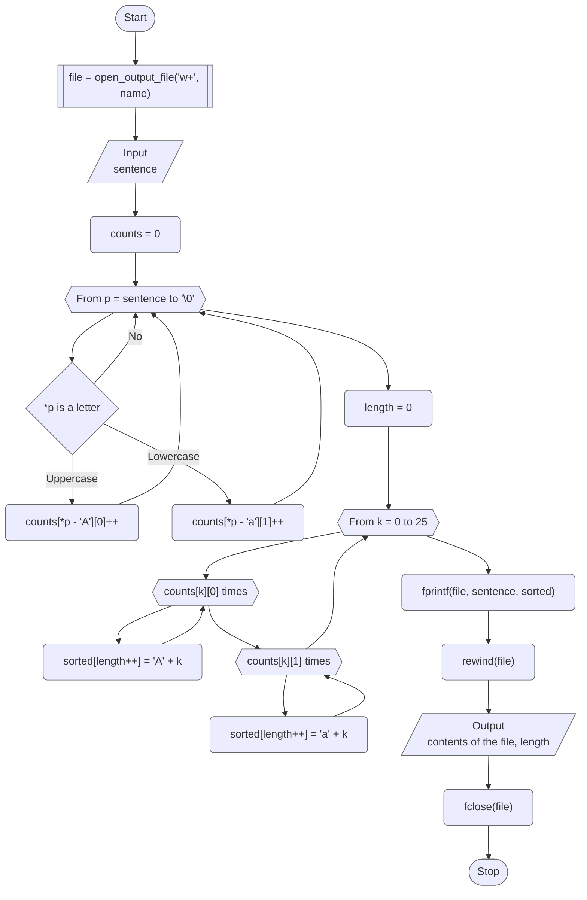
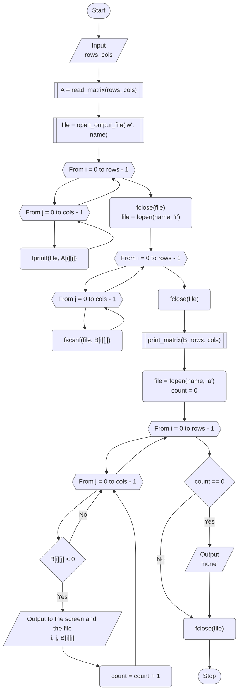
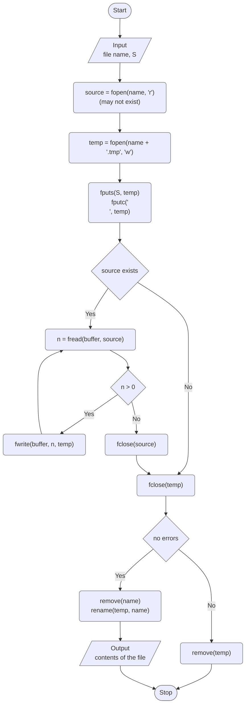

# Lab 08 - Streams and files

[Assignment](docs/lw-task-08.pdf) · [Report](docs/lw-report-08.pdf)

Variant 9. The goal of the lab is to learn to use text files and the basic
functions of the file system of the C language: to open a file in the needed
mode with `fopen()`, to write and read it with `fprintf()`, `fputs()`, `fgets()`,
`fscanf()` and `fread()` / `fwrite()`, to move to the beginning with `rewind()`,
and to close it with `fclose()`.

## Overview

| Task | What it does                                                                                                                        |
|------|-------------------------------------------------------------------------------------------------------------------------------------|
| 1    | Writes a sentence to a text file and all its letters in alphabetical order to the next line                                         |
| 2    | Writes an n x m matrix to a text file, reads it back, prints the negative elements with their coordinates and adds them to the file |
| 3    | Adds a line S to the beginning of a text file                                                                                       |

### Project layout

```
lab_08/
├── include/
│   ├── tasks.h   # task registry (X-macro), TASK_COUNT, run_task() / run_all_tasks()
│   ├── utils.h   # MAX_LINE_SIZE, validated input, read_text_line()
│   ├── files.h   # file functions: names, opening, printing, adding a line
│   └── matrix.h  # constants, matrix functions, Matrix type
└── src/
    ├── main.c    # menu, task number parsing, srand()
    ├── runner.c  # dispatches to run_task1() ... run_task3()
    ├── taskN.c   # each task 'N' in its own source file
    ├── ...
    ├── files.c   # implementation of file functions
    ├── matrix.c  # implementation of matrix functions
    └── utils.c   # implementation of utility functions
```

The input functions return `false` only when the input stream is over (EOF), so
a task never loops forever.

## Program flow



## Task 1 - A sentence and its letters in alphabetical order

The file is opened in the mode `w+` (reading and writing), as in Example 8.2 of
the assignment: the sentence and the sorted letters are written, `rewind()` moves
the position to the beginning, and the file is read back and printed, so the
screen shows what is really saved in the file. The work is split into functions:

| Function                             | Does                                                                          |
|--------------------------------------|-------------------------------------------------------------------------------|
| `open_output_file("w+", name, size)` | asks for a file name, asks to confirm overwriting, opens the file (`files.c`) |
| `read_text_line(prompt, text, size)` | reads the sentence, rejects a line that is too long (`utils.c`)               |
| `sort_letters(text, out)`            | writes the letters of the text in alphabetical order, returns their number    |
| `print_stream(file)`                 | prints the rest of the file to the screen (`files.c`)                         |

The letters are sorted by counting: `counts[k][0]` and `counts[k][1]` are the
numbers of the uppercase and lowercase occurrences of the `k`-th letter of the
alphabet. Then the loop goes over the alphabet and writes every letter as many
times as it occurred. This needs one pass over the text and 26 steps, and no
comparisons of letters.



## Task 2 - Negative elements of a matrix in a file

The work goes in four steps, with the file closed between them:

1. The matrix `A` is created (random or typed) and written to the file, one row
   per line, numbers separated by a space (`fprintf()`).
2. The file is opened for reading and the matrix is read back into `B` with
   `fscanf()`. The result of every `fscanf()` is checked: it must be `1`.
3. The matrix `B` is printed and its negative elements are found.
4. The file is opened in the mode `a` (appending) and the coordinates with the
   values are added to its end, and printed on the screen at the same time.

If there are no negative elements, the program writes `none`. The result of
`fclose()` is checked after writing, because the data from the buffer reaches the
disk only then.

| Function                                 | Does                                                               |
|------------------------------------------|--------------------------------------------------------------------|
| `read_matrix_size("the matrix", &r, &c)` | asks for the number of rows and columns `1...15` (`matrix.c`)      |
| `read_matrix("A", a, rows, cols)`        | fills the matrix with random numbers or asks for its elements      |
| `open_output_file("w", name, size)`      | asks for a file name and creates the file (`files.c`)              |
| `write_matrix_file(name, a, rows, cols)` | writes the matrix to the file, one row per line (`matrix.c`)       |
| `read_matrix_file(name, b, rows, cols)`  | reads the matrix back from the file, checks every `fscanf()`       |
| `print_matrix("A", b, rows, cols)`       | prints the matrix                                                  |
| `print_negatives(file, b, rows, cols)`   | prints the negative elements, adds them to the file, returns count |



## Task 3 - Add a line to the beginning of a file

A file cannot be extended at its beginning, so the new content is built in a
temporary file `<name>.tmp` next to the original one:

1. the line `S` and a newline are written into the temporary file;
2. the old content is copied after it with `fread()` / `fwrite()` in blocks of
   1024 bytes (the file is not read into memory as a whole);
3. the original file is deleted and the temporary one is renamed to its name
   (`rename()` does not replace an existing file on Windows, so `remove()` goes
   first).

Every step is checked. If writing fails, the temporary file is deleted and the
original file stays untouched.

| Function                            | Does                                                             |
|-------------------------------------|------------------------------------------------------------------|
| `read_file_name(name, size)`        | asks for a file name until it is not empty (`files.c`)           |
| `prepend_line(name, line)`          | adds the line to the beginning of the file, creates it if needed |
| `copy_stream(from, to)`             | copies the old content with `fread()` / `fwrite()`               |
| `replace_file(temp, name, existed)` | deletes the old file and renames the temporary one               |
| `print_file(name)`                  | prints the whole file to the screen                              |



## Results

| Task | Input                                                | Output                                                                                          |
|------|------------------------------------------------------|-------------------------------------------------------------------------------------------------|
| 1    | `I am a student of Khmelnytskyi National University` | file line 1: the sentence; line 2: `aaaadeeefhIiiiiKkllmmNnnnnoorssstttttUuvyyy`; letters: `43` |
| 1    | `123 !!`                                             | line 2 is empty; letters: `0`                                                                   |
| 2    | `2x3` matrix `1 -2 3` / `-4 5 -6`                    | file: the matrix, then `0, 1: -2`, `1, 0: -4`, `1, 2: -6`; negative elements: `3`               |
| 3    | file `line one` / `line two`, `S = NEW FIRST LINE`   | file: `NEW FIRST LINE`, `line one`, `line two`                                                  |
| 3    | a file that does not exist, `S = only line`          | the file is created with the single line `only line`                                            |

## Build & run

Standalone (from this directory):

```bash
make build
make run
```

From the repository root:

```bash
make build LAB=08
make run LAB=08
```
